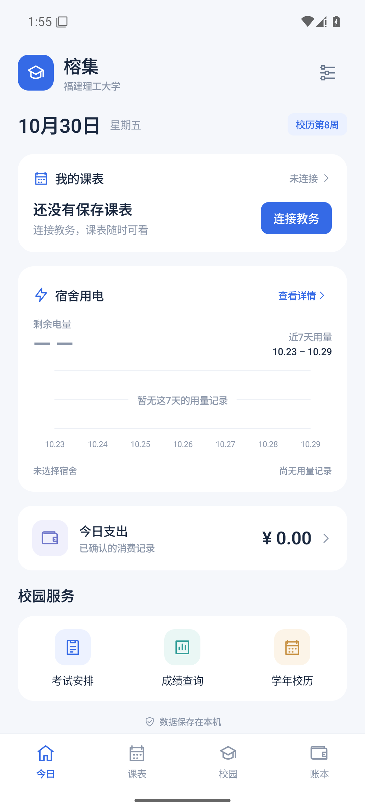
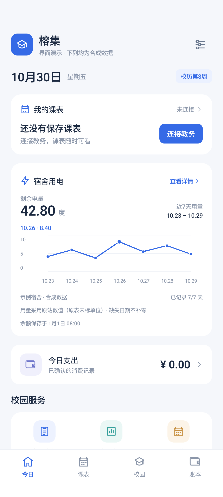
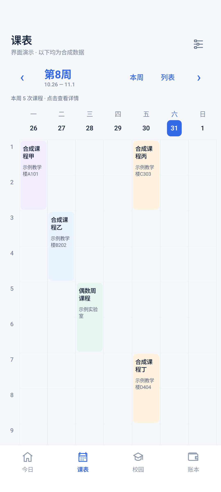

# 榕集 Rongji

福建理工大学个人安卓校园助手，把课表、教务查询、宿舍用电和日常账本集中在一个入口。“榕”取福州意象，“集”表示集中管理。

当前版本 **0.1.2-m0**，用于接入与交互验证，非学校官方应用。面向个人使用，业务数据保存在手机；可自选在本机加密保存教务及独立后勤账号，仍使用学校页面认证。

[下载安装包](https://github.com/yuj1ng1/my-campus/releases/tag/v0.1.2-m0) · [周课表与后勤连接记录](docs/07-0.1.2周课表与后勤连接.md) · [0.1.1 修复记录](docs/06-0.1.1接入修复与验证.md)

## 当前能力

- 课表、考试和成绩：应用内连接学校，查询后主动读取保存，离线查看已有结果。
- 周课表：七天课程格、节次定位、教学周切换、单双周筛选、课程详情及列表；已有课表直接转换显示，实践与无法排入固定时间的记录保留。
- 学校连接：复用本应用会话，可选本机加密凭据重登；验证码或拒绝登录时暂停自动登录。
- 可选自动更新：回到应用时检查已保存数据，后台约每 6 小时尝试，失败保留旧数据；系统调度、学校会话和查询条件会影响执行。
- 宿舍用电：余量（度）与近 7 个完整自然日的用量折线图；可查看每日数值，缺失日期不补零。
- 学年校历：内置学校公开的 2026—2027 学年校历，离线查看、缩放及官方来源入口。
- 本地账本：手动记支出；微信/支付宝通知先进入待确认，核对后入账，通知原文不保存。
- 首页：浅灰白底、蓝色操作区，集中显示课程入口、用电、支出和校园服务。

余额和日用量必须分别在学校页面查询保存，且属于同一房间。历史用量原表未标单位，图表按原站数值展示；余额明确使用“度”。

 

左图为空状态，右图为明确标注的合成数据演示，不包含真实学校查询结果。

## 试用

1. 在 Releases 下载 APK 并安装。
2. 打开对应校园功能，在学校页面完成登录、选学期或房间、执行查询。
3. 等待结果完成，点击顶部“读取并保存”，返回核对内容与保存时间。
4. 如需减少重复登录，打开右上角设置，选择加密保存账号和自动更新；无需把账号写入项目文件。
5. 后勤打开“后勤登录与连接”，普通水电查询链接即可保存。可另存独立后勤学号和密码；新会话仍需本人在学校页面填写手机号、短信验证码并核对绑定。应用不发送短信、不填写短信码、不自动提交绑定。手机号和验证码无需发送到项目或聊天。
6. 账本可先手动使用，通知访问按需从系统设置开启；无需为测试专门消费。

真实学校验证：API 35 Android WebView 的课表读取与会话复用已有证据。本次核对后勤普通入口进入手机号绑定页，实际账号填入检查通过，手机号和短信码保持空白；未完成绑定，因此未将新会话的余额、用量读取记录为成功。

目标手机为 iQOO Neo9 / OriginOS 6 / Android 16，仍需真机验收；模拟器和桌面浏览器通过不能代替真机结果，也不能保证永久免登录。

本版尚未提供课程/考试提醒、低电量提醒、真正自动入账、账本导出、手动调课；后勤绑定后读取、无人选房更新、成绩/考试非空真实结果仍待验证。

## 开发

原生 Kotlin + Jetpack Compose + Room；单个安卓应用，无自建后端。JDK 17、Android SDK 36，最低 Android 12 / API 31。工具和依赖固定版本见实测记录。

在不提交的 local.properties 配置 sdk.dir，然后执行：

    .\gradlew.bat :app:testDebugUnitTest :app:assembleDebug :app:assembleDebugAndroidTest :app:lintDebug

规则测试验证周次、金额、候选过滤、读取完整性、余额与日用量；设备测试验证页面、本地持久化、失败保留旧数据和宿舍隔离。真实学校结果、Android 16 后台及通知表现单独记录。

本轮测试、签名、覆盖安装及实际接入的分项结果见[周课表与后勤连接记录](docs/07-0.1.2周课表与后勤连接.md)。

## 设计文档

1. [需求与页面流程](docs/01-需求与页面流程.md)
2. [技术方案与数据设计](docs/02-技术方案与数据设计.md)
3. [开发计划与验收](docs/03-开发计划与验收.md)
4. [接入核验记录与来源](docs/04-接入核验记录与来源.md)
5. [M0 使用与验证记录](docs/05-M0使用与验证记录.md)
6. [0.1.1 接入修复与验证](docs/06-0.1.1接入修复与验证.md)
7. [0.1.2 周课表与后勤连接](docs/07-0.1.2周课表与后勤连接.md)

[学校公开校历原件](docs/sources/福建理工大学2026-2027学年校历.pdf)保留原始内容；来源和校验值见核验记录。

公开范围为源码、文档、数据库结构与学校公开资料。账号密码、Cookie、签名链接、实际查询结果、通知原文、本地配置、密钥和日志不进入仓库。
