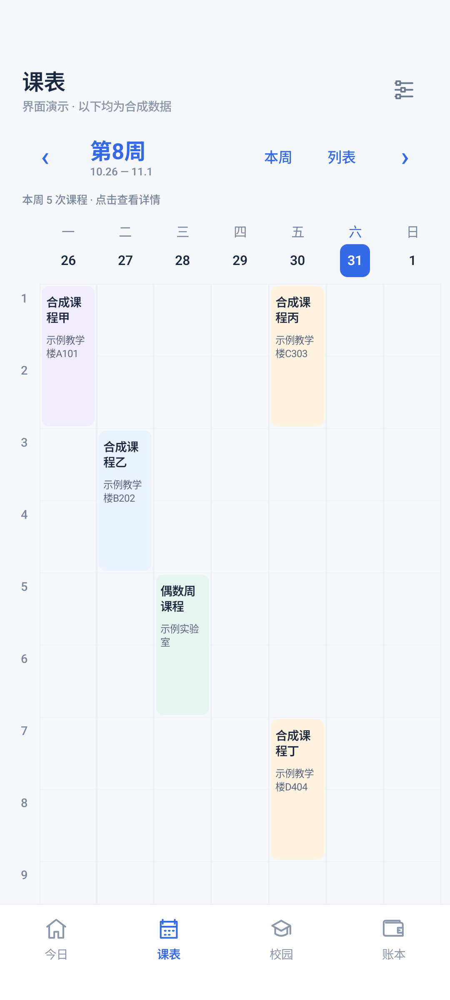

# 0.1.2 周课表与后勤连接

日期：2026-10-31，北京时间。版本：0.1.2-m0，versionCode 3。

本文保留为历史记录。最新课表首屏、后勤空白修复与“福理集”更名见[0.1.3 记录](08-0.1.3显示修复与更名.md)。

## 周课表

已有课程快照无需重新提取，直接按星期与节次转为七列周表。支持上一周、下一周、选择教学周、回到本周、切换学期、列表及点击课程详情。

周次使用已有解析规则，保留分段、单双周和不连续周次；只显示所选教学周实际包含的固定节次课程。同一天时段重叠的课程并列显示，不覆盖彼此。实践课程、无固定节次及不能可靠排入周表的记录保留在下方，避免静默丢失。

课程卡片按科目稳定配色，今日日期突出；详情保留原课程名、周次、节次、教室、教师和附加说明。时间轴使用节次，不补写尚未核实的上课钟点。当前已核对的 2026—2027 学年校历用于显示周日期；未配置的其他学年可按教学周浏览，不猜测开学日期。

已选学期的手动更新沿用该学期，不因另一份快照保存得较新而更新到别的学期。数据库表与版本仍为 1，不重建数据库。

上图由实际 Compose 周表组件渲染，全部课程和地点均为合成示例，不预置到应用数据中。

## 普通后勤链接为何变灰

0.1.1 的连接按钮只接受带临时签名的链接，拒绝普通水电查询入口。学校的普通入口本身会在页面中生成临时参数，这个限制过严。0.1.2 接受学校固定水电查询地址，保留 HTTPS、主机、路径、查询动作和重复参数校验；不需要用户手工获取或生成签名。

普通链接可以直接保存连接；其他主机、明文链接和不匹配的动作仍不能使用。带授权参数的旧链接仍按本机加密存储处理，动态参数不写入工程。

## 正确的手机认证流程

用户确认成功使用的是“手机号验证／立即绑定”页面。实际 Android WebView 也进入该页，包含 mobile、code、studentid、password 字段。已经核对的路由为同一学校主机的 /agent/app/index.php，i=67、c=entry、do=register、m=maihu_portal。

官方网站另有“系统登录＋图片验证码”入口；它与手机绑定页是不同流程，本版不把手机绑定页自动跳到该后台，也不把这两种验证码混用。本次没有提交图片验证码，没有请求或发送短信，没有确认绑定或充值。

新增独立后勤账号的自选本机加密保存，记录与教务账号分开，仍使用 Keystore AES-GCM。应用只在上述固定来源、同时具有已核实的四个字段和绑定页面标识时填入后勤学号、密码，不写入手机号或短信码，也不点击“获取验证码”或“立即绑定”。

本人在手机学校页面输入手机号、接收短信验证码并核对绑定，是新会话的前置步骤。完成后再选择宿舍、查询并保存余额及用量。服务器的绑定和有效期由学校决定，不承诺永久免登录。手机号和短信码不进入本应用的凭据记录、账本或诊断信息。

修改已保存的后勤学号时清理旧学校会话和电量缓存；课表、教务快照和账本保留。此时从标准后勤入口重新建立会话，避免沿用旧签名身份。

## 实际验证

| 项目 | 结果 |
| --- | --- |
| JVM 规则测试 | 39 项通过，失败、错误和跳过均为 0 |
| API 35 模拟器 | 28 项通过，失败和跳过均为 0；覆盖周切换、单双周筛选、课程详情、普通链接保存、错误主机禁用、身份字段填入、不触发短信或绑定、缓存隔离 |
| 真实学校手机绑定页 | 实际运行打包的 power-binding.js，后勤学号与密码字段匹配临时输入；手机号、短信码保持空白，通过 |
| 短信、绑定后余额/用量 | 未执行；需本人在手机完成验证后验收，不将账号填入成功当作登录或电量读取成功 |
| 0.1.1 到 0.1.2 覆盖安装 | 旧版写入一条合成已确认账目，覆盖安装后金额、状态、备注仍一致，通过 |
| 静态检查、签名与对齐 | Lint 0 错误、13 提示（8 项依赖/工具更新及 5 项 KTX 写法建议）；v2 验签及 16 KB 对齐通过，证书与旧版相同 |
| iQOO Neo9 / OriginOS 6 / Android 16 | 待真机验收；模拟器不能替代 |

实际绑定页探针只在运行时通过 ADB 回环通道接收本次授权的身份字段，检查仅输出状态和匹配布尔值，不将账户写入测试源码、日志或安装包。页面最初存在但仍隐藏时等待显示，不把“元素已创建”当作页面可以操作。

合成 WebView 测试另验证：账号填入不触发短信或绑定按钮、后台登录与其他主机不能接收身份字段、后勤与教务密码独立加密、跨账号清理电量缓存不删除教务与账本。失败与待手机号验证仍保留旧快照和成功时间。

## 使用

1. 覆盖安装新版，打开“课表”查看周表；无需删除旧应用或重新提取已有课表。
2. “校园 → 宿舍电量 → 后勤登录与连接”，普通入口即可连接；按需填写独立后勤账号并加密保存。
3. 新会话按学校页面要求本人完成手机号、短信码和绑定确认，然后选择宿舍查询。余额与房间用量仍需分别保存。
4. 遇到问题可复制连接诊断，勿发送手机号、验证码、密码或完整签名链接。

APK 大小为 31,718,699 字节，SHA-256：`8dabab71f5b26c39b2b9735fe6530a75d4498c299d294d55837c74ebb57fa319`。证书 SHA-256：`288a1decc858700d6c7213835ae2c11f7edda88894bf63ddbe5b478b49962cae`，与旧版一致。下载地址为 [v0.1.2-m0](https://github.com/yuj1ng1/fuliji/releases/tag/v0.1.2-m0)，同时提供 SHA256SUMS-0.1.2.txt；私钥不公开。
