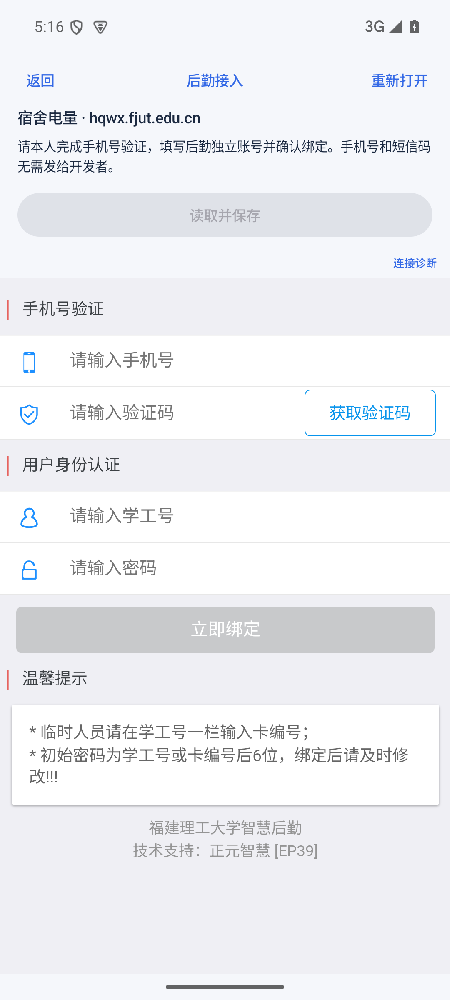
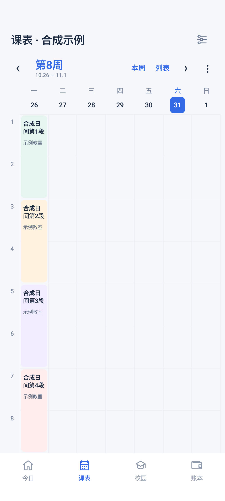

# 0.1.3 显示修复与更名

日期：2026-10-31，北京时间。当前名称：福理集；版本：0.1.3-m0，versionCode 4。

本文保留为历史记录。后续用量保存与每日更新修复见[0.1.4 记录](09-0.1.4用量保存与自动更新.md)。

## 后勤表单空白的原因

本次在实际 CampusWebActivity 窗口中复现，与此前独立铺满屏幕的 WebView 探针分开验证。原生网页区域宽 1080、高 1706 像素，网页输入框节点存在，但 HTML、body、page-group、当前 page 及 content 的高度被算成 0，overflow 裁切使整张表单不可见。仅检查字段存在或填入成功，不能证明用户能看到或操作它们。

学校页面在该嵌入窗口里对百分比及 vh 高度也得到 0，因此适配使用实际 innerHeight 的 CSS 像素值，限定在已核实的后勤手机绑定与水电查询页面。仅在外层折叠时启用，并随窗口或键盘高度更新；原本尺寸有效的页面保留原样，离开支持范围撤销适配。

短信与绑定的原有按钮、校验、请求及业务字段不改写。仍需本人在学校页面输入手机号、短信验证码并确认绑定；应用没有请求短信、填写短信码、提交绑定、充值或支付。

同时补充网页原生区域和外层高度诊断信息，均为尺寸、状态与数量，不包含输入值、完整地址或 Cookie。后勤界面为键盘预留区域。

修复后实际学校窗口中 body 为正高度，手机号输入框通过可见区域的触点命中检查，截图已核对。未完成本人短信绑定，不将表单显示成功写成余额/用量查询成功。

## 首屏四段日间课程

旧版每小节固定高度，顶部有应用标题、学校、学期操作、周切换、提示等多行，占用了网格空间。新版压缩课表顶栏，把学校查询、更新和学期选择收进“⋮”菜单；根据扣除所有顶部内容和底部导航后的实际高度分配第 1—8 小节。

这样上午两段、下午两段可完整显示，晚课第 9 小节起向下滑动。课程详情、单双周与分段周次、列表和实践记录继续保留，不缩改源课表内容。测试包含完整生产页面的顶栏、菜单与底部导航，不只渲染中间的网格组件。

## 更名与数据保留

软件名称改为“福理集”，同步更新桌面安装名称、首页、设置、分享入口、通知访问标签及诊断标题。包名、数据库、已保存凭据的命名空间、Keystore 密钥与后台任务身份保留；使用同一签名覆盖安装，不创建第二个应用。

## 验证结果

| 项目 | 结果 |
| --- | --- |
| JVM 规则测试 | 39 项通过，0 失败、0 错误 |
| API 35 设备测试 | 32 项通过，0 失败；包含实际读取脚本、周表与后勤布局回归 |
| 课表首屏 | 完整顶栏与底部导航下，第1—8小节全部在可见区；360×680 dp 及1.25倍字体测试通过，晚课可滚动查看 |
| 实际学校后勤窗口 | 高度适配后表单已显示，手机号输入框触点命中通过；所有身份字段为空的截图已核对 |
| 网页输入与布局回归 | 合成零高度页面在实际应用窗口恢复显示，原生触摸能聚焦手机号输入框；健康页面保持尺寸、离开支持路径撤销适配；均通过 |
| 静态检查 | Lint 0 错误、13 项警告，保留依赖更新及 Kotlin 扩展建议 |
| 覆盖安装、签名、对齐 | 0.1.2 覆盖升级至 0.1.3 后合成账本记录保留；APK v2 验签与 16 KB 对齐通过，证书与旧版相同 |
| 指定 iQOO / OriginOS 6 / Android 16 | 尚待真机复测；本机使用 API 35 模拟器 |
| 本人短信绑定及其后的余额/用量 | 尚待本人在手机完成和验收 |

演示周表全部是合成数据；后勤截图为真实空白认证表单，不含学号、密码、手机号、短信码、宿舍或电量结果。测试账户不进入源码或公开 APK。

下载见 [v0.1.3-m0](https://github.com/yuj1ng1/fuliji/releases/tag/v0.1.3-m0)。安装包 `fuliji-0.1.3-m0.apk`，31,581,645 字节，SHA-256：

    2f177d661a28becd4cb19c6e5263d732ae7b48681e00bdd20778f0979a04853f

签名证书 SHA-256（与旧版相同）：

    288a1decc858700d6c7213835ae2c11f7edda88894bf63ddbe5b478b49962cae
