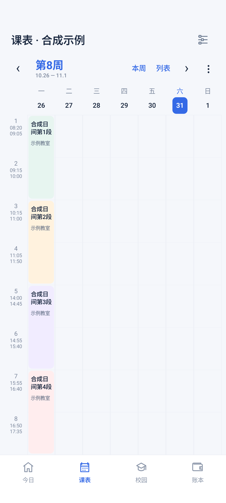

# 0.1.5 首页双版、节次时间与账本统计

日期：2026-10-31，北京时间。软件名称“福理集”，版本 0.1.5-m0，versionCode 6。

## 首页两版

两版在同一个安装包中直接切换，默认“今日课程”，选择保存到本机。没有放入演示课表或演示账目作为正式应用数据。

| 今日课程 | 下一节课 |
| --- | --- |
|  |  |

今日版按当前日期、教学周、单双周与星期列出当天固定节次课程，含起止时间、教室和课段状态。下一节版取当天尚未开始的最近时间，同时开始的课程均保留；正在进行的课段另行标注。课段是合并节次的起止时段，包含课间间隔，并不声称课间也在授课。

当天没有后续课程时不跳到明天；未知学期日期与日期不在已保存学期内分别提示，不误报成“今天无课”。实践、待核对及未知节次时间仍有提示，不静默丢失。优先使用当前学期的已保存课表；时间和日期取北京时间，同一时钟快照避免午夜日期、时刻分开采样。前台每分钟刷新，恢复前台时重新取时。临时调课仍以学校新查询及保存结果为准。

完整首页预览：[今日课程](images/fuliji-home-today.png)、[下一节课](images/fuliji-home-next.png)。全部课程与金额均为合成样例。

## 节次时间来源

以下按用户提供的参考截图录入，没有外推第 11 节及之后的钟点。周表、课程详情、列表和首页共用这张时间表。

| 节次 | 开始 | 结束 |
| --- | --- | --- |
| 1 | 08:20 | 09:05 |
| 2 | 09:15 | 10:00 |
| 3 | 10:15 | 11:00 |
| 4 | 11:05 | 11:50 |
| 5 | 14:00 | 14:45 |
| 6 | 14:55 | 15:40 |
| 7 | 15:55 | 16:40 |
| 8 | 16:50 | 17:35 |
| 9 | 18:30 | 19:15 |
| 10 | 19:25 | 20:10 |

左侧时间轴加宽至可显示钟点，依然按可用高度安排首屏第 1—8 小节；晚课下滑查看。更晚节次显示“待补充”，首页不把未知钟点强行排成下一节。

## 账本统计与记账原理

账本新增本月支出、今日支出、近 7 天消费曲线，点击日期查看精确金额。消费窗口包含今天及之前 6 天，今天持续累计；按本机有效金额、CONFIRMED、EXPENSE 记录汇总，月统计为本月 1 日至今天。通知记录以通知时间归属日期，确认时不改变原日期。所有汇总先用整数分求和，避免小数误差与 Long 汇总溢出；图形比例的浮点计算不作为金额来源。

现有流程为 Android NotificationListenerService → 微信/支付宝包名与支付标题过滤 → 金额、状态识别 → DRAFT → 本人核对确认为支出。候选及手动账目保存在 Room；通知正文不持久化。完全相同事件按哈希标识去重，通知更新仍可能形成另一候选。失败/未付款通知被过滤，无法唯一确定金额时需补充；不是账单接口，不回读历史，也不能保证实际消费一笔不漏、不重。

待确认、退款、收款、转账、充值默认不计入支出；退款不自动冲减。确认、删除后从同一账本数据流重算，不新增另一份统计账本。图上 0 表示没有已确认本地支出记录，不等于当天一定没有真实消费。

## 仓库更名和 README

公开仓库更名为 [yuj1ng1/fuliji](https://github.com/yuj1ng1/fuliji)，保留同一仓库 ID、全部提交、5 个既有发布版本及安装包。已核对旧版 0.1.4 安装包摘要未改变，更新既有发布说明内的仓库链接。本地 origin 与根工程名同步到 Fuliji；更新 README 的功能、预览、通知记账原理、使用步骤、验证边界和下载地址，历史文档链接指向新仓库。

安卓包名、数据库结构、Keystore 与后台任务标识沿用；没有通过仓库改名创建第二个应用或清空数据。

## 验证

| 项目 | 结果 |
| --- | --- |
| JVM 规则测试 | 48 项通过，0 失败、0 错误 |
| API 35 全量设备测试 | 43 项通过，135.578 秒；11 项相关界面专项测试另行通过 |
| 首页 | 今日课程、最近未开课、单双周、相同开始时间、上课/下课边界、未知学期与晚间未知时间；两版实际 Compose 截图已目视核对 |
| 时间轴 | 360×680 dp 与 1.25 倍字体下，日间四段课程和第 8 节结束时间均完整可见；晚课滚动后 19:25、20:10 可见 |
| 账本 | 本地月界、当天包含、空日 0、待确认排除、确认/删除重算、保留通知日期、超 Long 总额仍精确到分；图表可点选 |
| 静态检查 | Lint 0 错误、14 项警告：依赖更新与 SharedPreferences KTX 建议，未做无关依赖升级 |
| 覆盖升级 | 0.1.4 → 0.1.5 合成账本保留，签名与旧版一致 |
| 真机边界 | 新界面、真实支付通知接收和长期后台表现仍待 iQOO Neo9 / OriginOS 6 / Android 16 验收；用户前次截图已确认用电余额与 7 天曲线展示，但不据此宣称后台长期验证完成 |

所有新界面预览都来自实际应用组件的模拟器渲染，业务数据全部合成；没有将用户截图里的课程、宿舍或消费结果写入 APK、源码与公开文档。

## 安装包

`fuliji-0.1.5-m0.apk`，31,607,649 字节；APK v2 验签与 16 KB 对齐通过，签名证书与旧版相同。SHA-256：

    b446d938c0e79bc759fbe9862c4805935288b17258ef752b296b117dd158db5c

下载见 [v0.1.5-m0](https://github.com/yuj1ng1/fuliji/releases/tag/v0.1.5-m0)。
